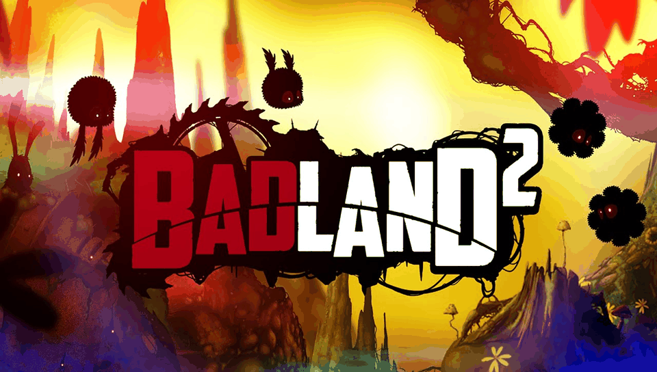

<h1 align="center">
  <br>
  Badland 2 · PS Vita Port
</h1>

<p align="center">
  <b>Native port of Badland 2 (Frogmind) for PlayStation Vita and PlayStation TV.</b>
</p>

<p align="center">
  
  
  
  
  
  
</p>

<p align="center">
  <a href="#-description">Description</a> •
  <a href="#-features">Features</a> •
  <a href="#-controls">Controls</a> •
  <a href="#-installation">Installation</a> •
  <a href="#-known-issues">Known Issues</a> •
  <a href="#-building-from-source">Build</a> •
  <a href="#-credits">Credits</a>
</p>

---

## 📖 Description

**Badland 2** is the side-scrolling flight game by **Frogmind**, originally released for Android as
`badland-2-1-0-0-1062.apk` (v1.0.0.1062). This port runs the game's ARMv7 native library (`libbadland2.so`)
directly on the PS Vita's ARM Cortex-A9, using a dynamic shared-library loader (*so-loader*) and a custom
`FalsoJNI` bridge that implements the Android/JNI calls the game makes. [vitaGL](https://github.com/Rinnegatamante/vitaGL)
provides the OpenGL ES 2.0 rendering backend, FMOD's Android `AudioTrack` output is bridged to the Vita's
`SceAudioOut`, and the Android, Facebook and IAP services are stubbed for offline play. The engine is Frogmind's
own (the `b::` namespace in the binary), not Cocos2d-x.

---

## 🎮 Status & Playability

**Status: In-game (v1.20)**. On real hardware the game reaches the in-game Genesis level (user-confirmed); the rest
of the campaign has not been confirmed yet.

- [x] **Loader and bootstrap**: `libbadland2.so`, `libfmod.so` and `libfmodstudio.so` load and run; the v1.1 release
  build boots on the console. *Verified on console.*
- [x] **Graphics**: vitaGL, 960x544 native resolution, persistent shader cache under `ux0:data/badland2/cache/`.
  60 FPS seen on the Genesis level in a user screenshot. *Verified on console.*
- [x] **Touch**: multi-touch with up to 5 fingers. The author calls the touchscreen the reliable control. *Verified on console.*
- [ ] **Audio**: FMOD's AudioTrack output bridged to `SceAudioOut` at 44.1 kHz. Fixes are in the code; not yet confirmed on the console.
- [ ] **Physical controls**: flaps on L / R / D-Pad / Stick / Cross are weak in gameplay.
- [ ] **Saves**: crash and progress-loss fixes are in the code; not yet re-verified on the console.
- [ ] **Trophies**: the set installs on hardware; unlocks are not confirmed yet.
- [ ] **IAP unlock and online UI hiding** (v1.20): not tested on the console.

### Changelog

**v1.20** (`CMakeLists.txt`, `VITA_VERSION` 01.20)
- **Native trophies:** 79 achievements + Platinum, via a `reportAchievement` hook (see [Trophies](#-trophies)).
- **Premium unlocked + online UI hidden (untested on console):** the IAP check returns "purchased" for the
  unlock-all, no-ads, worlds and lives products; online-only UI nodes are hidden and cannot be touched.
- **Save and progress fixes (untested on console):** `rewind()` now goes through the SceLibc bridge, so the save
  file loads from the start (before, progress was lost between sessions). A level-change crash is fixed by
  skipping empty state slots during `StateManager::recreateAllStates`.

**v1.1** (bug-fix release, `RELEASE.md`)
- **Game data filename fixed:** `libbadland2.so` is loaded as documented (`main.so` is still accepted).
- **Release-build launch crash fixed:** the call to libfmod's `JNI_OnLoad` sat inside a debug-log macro that is
  compiled out in Release builds, so FMOD crashed at startup. The call now always runs.
- **Flap controls:** flaps are driven through the analog joystick axes.
- **Touchscreen fixed:** fingers are mapped to free slots 0–4 with per-finger DOWN/UP events (multi-touch works).
- **Touch input lag fixed:** hardware polling is capped to once per ~8 ms.
- **Audio fixed:** `supportsLowLatency()` returns false, so FMOD uses the AudioTrack → `SceAudioOut` bridge
  instead of OpenSL ES (FMOD error 51).
- **FPS drops fixed:** log lines are synced at most every 200 ms.
- **Save crash fixed:** the hook now targets `JNI_getLoginState` (hooking the 4-byte `FacebookAndroid::getState`
  overwrote `JNI_getUserId`).
- **Buttons:** Start opens the pause menu; Circle is unmapped.
- **Pause crash fixed:** `IAP::isNetConnected()` and `IAPAndroid::IsNetConnected()` return offline, and the
  Facebook friends / challenge / rush requests are safe no-ops.

**v1.0** (first release)
- Native resolution 960x544 at 60 FPS, with a persistent vitaGL shader cache under `ux0:data/badland2/cache/`.
- Dual-flap controls mapped to the L / R triggers, D-Pad, left stick and Cross; Start pauses.
- FMOD audio bridged to `SceAudioOut`; full multi-touch input.
- Offline stubs: Facebook and Cheetah Mobile servers are bypassed, social friend requests and online challenge
  leaderboards are no-ops, and IAP verification is stubbed.

---

## ✨ Features

| Feature | Status | Notes |
| :--- | :---: | :--- |
| Boots to gameplay | ✅ | Reaches the in-game Genesis level on hardware (user-confirmed); the v1.1 release build boots on the console |
| Graphics / renderer | 🧪 | vitaGL, 960x544 native resolution, GLSL shaders with a persistent shader cache (`ux0:data/badland2/cache/`). 60 FPS seen in a user screenshot |
| Audio & music | 🧪 | FMOD Studio's AudioTrack output bridged to `SceAudioOut` at 44.1 kHz; the fixes are in the code, not yet confirmed by ear on the console |
| Video / cutscenes | ➖ | No video files in the APK (`.mp4/.ogv/.webm`); port notes mark FMV as probably not applicable |
| Physical buttons | 🟡 | Flap mapped to L / R / D-Pad / Cross. The author reports the physical flap buttons are weak in gameplay |
| Analog sticks / camera | 🟡 | Left stick flaps in the direction it is tilted; same weakness as the buttons. No camera control |
| Touch screen | ✅ | Multi-touch (up to 5 fingers) with per-finger down/up events; the author's reliable control |
| Button remapping / port menu | ➖ | Not implemented; the Circle button is intentionally unmapped |
| Save data | 🧪 | Saves in `ux0:data/badland2/`. The save-crash and progress-loss fixes (v1.1, v1.20) are not re-verified on the console |
| Native trophies | 🧪 | 80 trophies (79 achievements + Platinum) installed on hardware (log 024). Unlocks not confirmed yet: the test session only reached one level |
| Languages | 🧪 | System language is read at boot and mapped to the game's language index; not verified per language |
| Performance | 🟡 | 60 FPS seen on the Genesis level in a user screenshot; FPS drops from file logging were fixed in v1.1 |
| Online / IAP / ads | 🟡 | Facebook, leaderboards and cloud saves are stubbed (offline). IAP unlocks are applied by a hook, not tested on the console |
| PS TV | 🧪 | Same build as PS Vita; PS TV not tested |

Legend: `✅ Working (verified on console) · 🧪 Implemented, not yet verified on console · 🟡 Partial · ❌ Not working · ➖ Not applicable · ❔ Not documented yet`

---

## 🎯 Controls

| Vita input | Action |
| :--- | :--- |
| **L Trigger** | Flap Left (fly towards left) |
| **R Trigger** | Flap Right (fly towards right) |
| **Cross (×)** | Dual Flap (ascend / forward) / Menu Confirm |
| **Left Stick** | Directional Flap (tilt Left/Right to flap in that direction) |
| **D-Pad Left / Right** | Flap Left / Flap Right |
| **Start** | Pause Game / Resume |
| **Touchscreen** | Native Touch Controls (tap left/right side of the screen to flap), up to 5 fingers |

> **Note:** Physical flap buttons (L / R / D-Pad / Stick / Cross) are still weak in gameplay. The touchscreen is the
> reliable control for now. Circle is intentionally unmapped.

---

## 🏆 Trophies

80 native PS Vita trophies (79 achievements + Platinum, communication ID `BADL00002`), added in v1.20. The trophy
pack is `sce_sys/trophy/BADL00002_00/TROPHY.TRP`, generated from `extras/trophy/trophies.json` (achievement table
`BL2_ACHIEVEMENTS`). Achievements are reported by hooking the game's `SocialManager::reportAchievement` (completed =
100 %), because the Android Google Play Games path never runs on the Vita.

The trophy set installed correctly on hardware. The unlock path is not confirmed yet: the test session only reached
the Genesis level, where no achievement applies.

---

## 📋 Prerequisites

Make sure your PS Vita is running **HENkaku / Enso** on firmware **3.60 or 3.65** and has these plugins:

1. **[kubridge.skprx](https://github.com/TheOfficialFloW/kubridge/releases)** (v0.3.1 or higher)
2. **[fd_fix.skprx](https://github.com/TheOfficialFloW/FdFix/releases)** (or repatch / rePatch reLoaded)
3. **libshacccg.suprx** runtime shader compiler (can be extracted with **[ShaRKBR33D](https://github.com/Rinnegatamante/ShaRKBR33D)**).
4. A legally purchased copy of **Badland 2** (v1.0.0.1062 or a compatible ARMv7 build) in `.apk` format.

---

## 📦 Installation

1. Install the latest **`badland2.vpk`** on your PS Vita using VitaShell.
2. Open your `.apk` with an archive manager (7-Zip, WinRAR, `unzip`, ...).
3. From `lib/armeabi-v7a/`, extract `libbadland2.so`, `libfmod.so` and `libfmodstudio.so`.
4. Extract the entire `assets/` directory from inside the APK.
5. Copy everything to `ux0:data/badland2/`:
   ```text
   ux0:data/badland2/
   ├── libbadland2.so
   ├── libfmod.so
   ├── libfmodstudio.so
   ├── audio/
   ├── config/
   ├── level/
   ├── scene/
   ├── textures/
   └── cache/                <- created by the game (shader cache)
   ```
   > Keep the original filename `libbadland2.so`. v1.0 only found the game if it was renamed to `main.so`
   > (v1.0 workaround); since v1.1 both names work.
6. Launch **Badland 2** from the LiveArea.

> First boot takes a few extra seconds while the game compiles and caches its runtime shaders. Later launches are much faster.

Crash dumps (`*.psp2dmp`) are written by the system to `ux0:data/`. The optional file logs (`ENABLE_FILE_LOG` builds) go
to `ux0:data/badland2/logs/`.

---

## 🐛 Known Issues

- **Physical flap buttons are weak**: L / R / D-Pad / Stick / Cross barely move the creature in gameplay. Use the touchscreen for now.
- **Online features are unavailable**: Facebook, leaderboards and cloud saves are stubbed out. Online leaderboards and
  cloud saves are unavailable because the servers are retired.
- **First boot** compiles and caches shaders (a few extra seconds).
- **Trophy unlocks not yet confirmed** on the console (the installed set is confirmed).
- **Tutorial-level crash** (prefetch abort in `b2Contact::Destroy`, log 016) is recorded in the port notes as unresolved. It was seen before the touch-input fixes and has not been re-checked.
- **Not verified on the console**: audio after the v1.1 fixes, the v1.20 save fixes, and the IAP unlock hook.
- **Crash dumps and logs**: attach the newest `*.psp2dmp` from `ux0:data/` together with the newest
  `ux0:data/badland2/logs/badland2_NNN.log` when you open an issue. The repository's `logs/` folder holds the dumps and
  logs used during development.

---

## 🔨 Building from Source

To build the port with the official [VitaSDK](https://vitasdk.org/):

```bash
git clone https://github.com/MetalSyntax/Badland-2-vita.git
cd Badland-2-vita
git submodule update --init --recursive   # lib/falso_jni (FalsoJNI)

export VITASDK=/path/to/vitasdk
export PATH=$VITASDK/bin:$PATH

cmake -B build -S . -DCMAKE_TOOLCHAIN_FILE=$VITASDK/share/vita.toolchain.cmake -DCMAKE_BUILD_TYPE=Release
cmake --build build -j$(nproc)
```

The resulting `badland2.vpk` and `eboot.bin` are written to `build/`.

Notes from the port notes:
- vitaGL is built automatically from `vendor/vitaGL` with `SOFTFP_ABI=1 NO_DEBUG=1 NO_SPLASHSCREEN=1 HAVE_SHADER_CACHE=1`.
- If the VitaSDK toolchain file rejects your CMake version, the port notes configure with `-DCMAKE_POLICY_VERSION_MINIMUM=3.5`.
- `DATA_PATH` and `SO_PATH` are cache variables: pass `-DSO_PATH=...` or clean the build directory after changing them.
- The CMake `send` target FTPs `eboot.bin` to the console at the `PSVITAIP` cache variable and launches it; `dump`
  runs `extras/scripts/get_dump.sh` to pull crash dumps.

---

## 📁 Project Structure

- `source/`: loader and bootstrap (`main.c`, `init.c`), JNI bridge (`java.c`, `generated_jni_*`), `.so` patches
  (`patch.c`), dynamic library and libc shims (`dynlib.c`), input queue, trophies (`trophies.c`).
- `source/reimpl/`: Android/bionic reimplementations (logging, configuration, EGL/GL glue).
- `lib/`: auxiliary libraries (`so_util`, `falso_jni` submodule, `kubridge`, `libc_bridge`, `fios`, `sha1`).
- `vendor/vitaGL/`: vitaGL built from source (LGPL-3.0, see `vendor/vitaGL/COPYING.LESSER`).
- `extras/`: LiveArea assets (`livearea/`), trophy data (`trophy/`), scripts (`scripts/get_dump.sh`).
- `decompiled/apk_jadx/`: jadx output of the APK's Java code (used for the JNI analysis).
- `screenshots/`, `logs/`: development captures and device logs.
- `PORTING_PLAN.md`: plan and engine analysis. `port_progress.md`: phase-by-phase log of bugs and fixes.
- `RELEASE.md`: release notes.

---

## 📜 Disclaimer

**Badland 2** and the *Badland* series are the property of **Frogmind**. This project is unofficial and is not
produced, endorsed or sanctioned by Frogmind.

This software does NOT contain original game code, binaries, graphics, audio or other game assets. The authors
do not promote or condone piracy in any way. To play, you must provide your own legally obtained copy of the
game in `.apk` form.

---

## ☕ Support My Work

This project is **free** and will stay free. If you enjoy it, a tip from **$1** helps me keep porting games to the PS Vita:

<p align="center">
  <a href="https://ko-fi.com/metalsyntax"></a>
</p>

- **Ko-fi:** [ko-fi.com/metalsyntax](https://ko-fi.com/metalsyntax)
- **PayPal:** [paypal.me/MetalSyntax](https://paypal.me/MetalSyntax)
- **Bitcoin (BTC):** `133HdCsaWxdjTfmwpgGVykByhNBV338uRc`

**Ko-fi supporters get:**
- **Early access** to new ports before their public release (test builds of upcoming projects).
- **Data preparation scripts and step-by-step guides** to set up your own game files for each new port.
- A say in which games I port next.

> Game files are never distributed. You always need your own legally obtained copy of the game.

---

## 👥 Credits

- **Frogmind**: original developer of *Badland* and *Badland 2*.
- **MetalSyntax**: this port.
- **TheFloW**: for the original `so-loader` concept, `kubridge` and `fd_fix`.
- **Rinnegatamante**: for [vitaGL](https://github.com/Rinnegatamante/vitaGL), [ShaRKBR33D](https://github.com/Rinnegatamante/ShaRKBR33D) and continuous support across the PS Vita homebrew ecosystem.
- **Volodymyr Atamanenko (v-atamanenko)**: for [FalsoJNI](https://github.com/v-atamanenko/FalsoJNI) and the soloader boilerplate architecture.
- **Vita community**: to all developers and enthusiasts in the PS Vita homebrew community.

---

## 📄 License

The loader code is licensed under the MIT License (see [LICENSE](LICENSE)): Copyright (C) 2021 Andy Nguyen,
Copyright (C) 2021-2022 Rinnegatamante, Copyright (C) 2022-2024 Volodymyr Atamanenko.

`vendor/vitaGL` is licensed under the GNU LGPL v3 (see `vendor/vitaGL/COPYING.LESSER`). `lib/falso_jni` carries its own
LICENSE file. The game, its assets, its `.so` files and FMOD remain the property of their owners and are not
distributed with this project.
